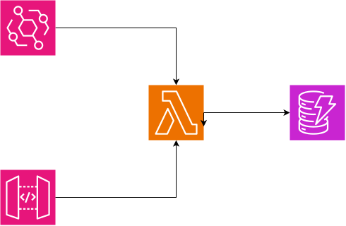

# orders-test

Orders Lambda (JavaScript): one handler for `CreateOrder` and `CancelOrder`, triggered by
EventBridge and a REST API (API Gateway), storing orders in DynamoDB.

## Architecture



The diagram is a draw.io SVG: open `docs/architecture.drawio.svg` in draw.io (or the VS Code
Draw.io extension) to edit it; the source is embedded in the file.

## Running the flows

From this folder:

```bash
go run ./tools test eventbridge   # invoke the Lambda with events/*.json (sam local invoke)
go run ./tools test api           # call the local REST API (sam local start-api, port 3050)
```
